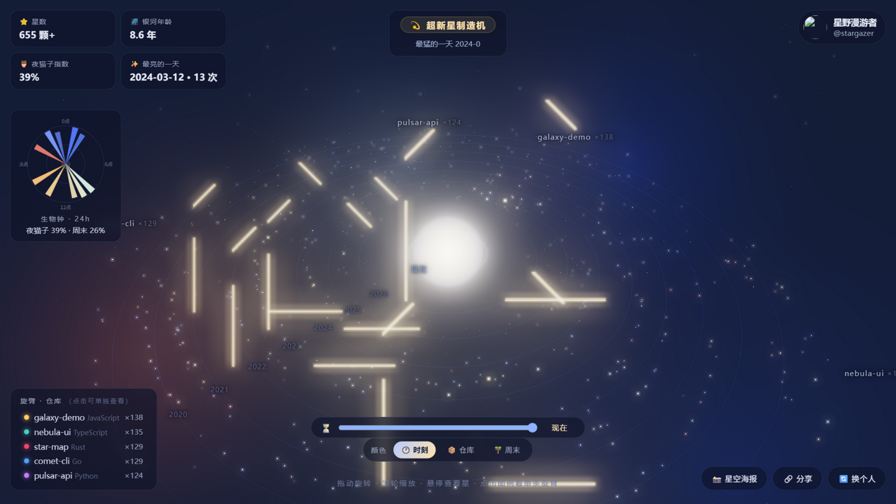
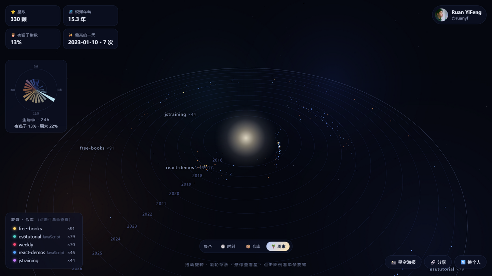
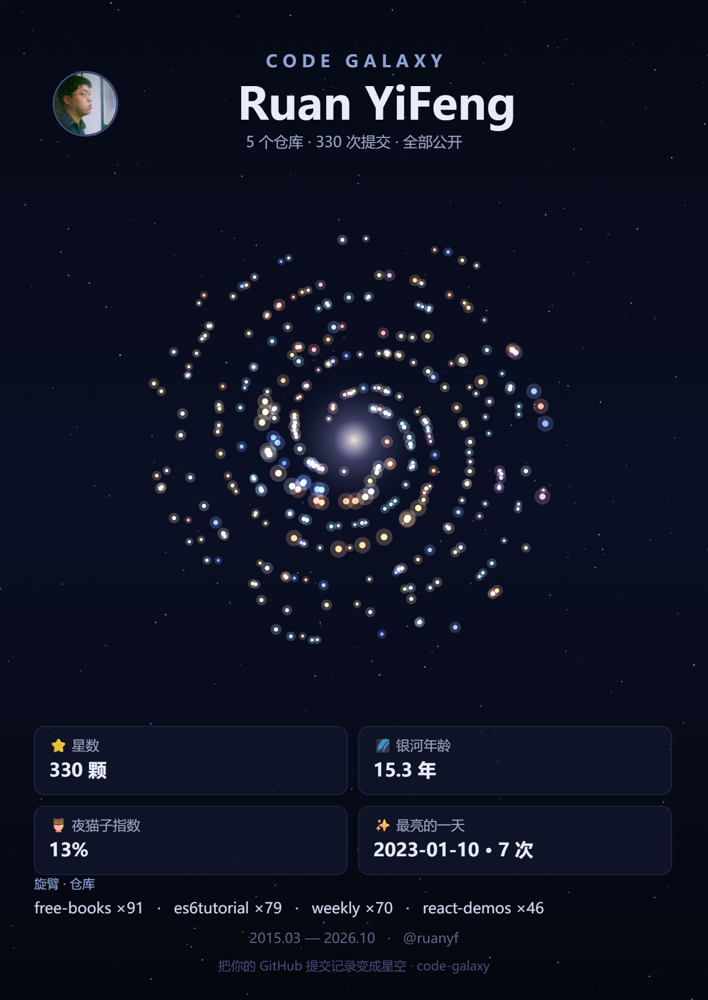

# 🌌 代码银河 Code Galaxy

> 把你的 GitHub 提交记录变成一片星空 —— 每个仓库是一条旋臂，深夜提交偏蓝、白天偏暖，高产的日子更亮。

**[🚀 在线体验](https://cchichi.github.io/code-galaxy/)** · 输入任意 GitHub 用户名即可，无需登录。



## 这是什么

输入一个 GitHub 用户名，[代码银河](https://cchichi.github.io/code-galaxy/) 会读取TA的公开提交记录，在浏览器里渲染出一片独一无二的 3D 星系：

| 星系元素 | 对应的数据 |
| --- | --- |
| ⭐ 每一颗星 | 一次公开提交 |
| 🌀 每条旋臂 | 一个仓库（标签实时跟随旋臂末端） |
| 📏 半径 | 全局真实时间，**越新的提交越靠近银心**——银心就是现在的你，年份环从外向内读 |
| 🎨 星点颜色 | 三种读法一键切换：🕐 提交时刻（凌晨深蓝 → 正午暖白 → 傍晚橙）/ 📦 仓库 / 🌴 工作日-周末 |
| ✨ 星点亮度 | 当天的提交密度，高产的日子形成亮星云 |
| 💫 巨新星 | 单日提交最多的几天，化作带十字星芒的金色大星 |
| 🌰 银河亮核 | 「现在」，随你的提交频率呼吸脉动 |



- **🎬 宇宙诞生动画**：星星按时间顺序从最古老的年代逐颗点亮，向银心汇聚成河
- **⏳ 时间旅行**：拖动底部滑杆回溯年份，银河「倒带」到过去的自己
- **🏅 银河判词**：根据数据自动生成专属称号（夜航星系 / 超新星制造机 / 周末战士…）与一句话解读，并印在海报上
- **3D 漫游**：拖动旋转、滚轮缩放，Bloom 辉光渲染，星系缓缓自转
- **每颗星可交互**：悬停查看提交信息（含当日提交数），点击直达该 commit
- **旋臂过滤**：点击图例中的仓库，单独点亮一条旋臂
- **生物钟玫瑰图**：24 小时提交分布极坐标图，附夜猫子 / 周末指数
- **统计面板**：星数、银河年龄、夜猫子指数、最亮的一天
- **📸 星空海报**：一键生成竖版 PNG 海报（含判词称号），保存你的银河
- **🔗 分享链接**：`?u=用户名` 直接打开别人的银河；`?demo=1` 离线演示模式（不访问 API）



## 快速开始

打开 [在线版](https://cchichi.github.io/code-galaxy/)，输入用户名（比如 `ruanyf`、`torvalds`）即可。

不填 Token 也能用（匿名额度每小时 60 次 API 调用）。如果需要抓取更多仓库与提交历史，可以填入自己的 [Personal Access Token](https://github.com/settings/tokens)（不需要任何权限勾选，public 访问即可）——**Token 只保存在你浏览器的 localStorage 里，不会发送到任何第三方服务器**。

## 本地运行

纯静态站点，零构建、零依赖、无后端：

```bash
git clone https://github.com/cchichi/code-galaxy.git
cd code-galaxy
python -m http.server 8000   # 或 npx serve
# 打开 http://localhost:8000
```

## 工作原理

1. 调用 GitHub 公开 REST API：`/users/:login` → `/users/:login/repos`（按星数与活跃度挑选最亮的仓库）→ `/repos/:o/:r/commits?author=:login`
2. 过滤合并提交（`Merge pull request …`），剩下的每次提交生成一颗星
3. 用登录名作为随机种子做确定性映射：同一个人每次生成的银河完全一致
4. three.js 自定义着色器渲染星点（加色混合、闪烁动画），纯浏览器本地计算

已知限制：`author` 参数依赖 GitHub 的邮箱关联识别，未绑定邮箱的提交不会出现；匿名模式下每个仓库最多读取最近 100 次提交（填 Token 可到 300 次并覆盖更多仓库）。

## 隐私

- 没有后端、没有统计脚本、没有 Cookie
- 只请求 GitHub 官方 API 与 CDN 上的 three.js
- Token（如果填写）只留在本地

## English

**Code Galaxy** turns any GitHub user's public commits into a unique 3D spiral galaxy, rendered entirely in your browser: every commit is a star, every repo is a spiral arm, and radius maps to real time so faint year-rings make the galaxy readable as a timeline. Switch star colors between time-of-day, repo, and weekday/weekend readings; the busiest days become giant golden stars; a 24-hour "biological clock" rose chart reveals your rhythm. Hover a star to see the commit, click to open it on GitHub, and export a shareable poster PNG.

Static site, zero build, no backend. [Try it live](https://cchichi.github.io/code-galaxy/).

## License

[MIT](LICENSE)
